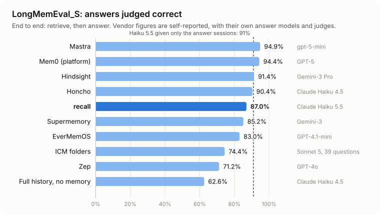
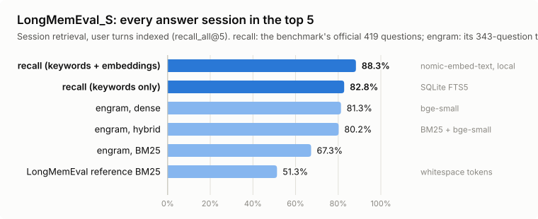
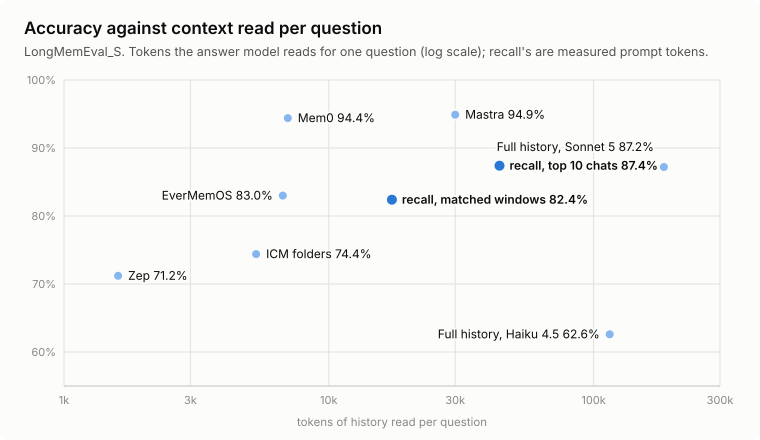

# recall

**One memory for all your coding agents.**

[](https://github.com/alirng/recall/actions/workflows/ci.yml)
[](LICENSE)


Your coding agents forget everything between sessions, and none of them knows what you told
the others. recall reads the chat history that Claude Code, Codex and Cursor already keep on
your machine, and gives every agent two things:

- **Search across every chat.** "Find the Cursor chat where we planned the auth refactor"
  works in any agent, whichever tool the chat happened in.
- **Memory.** A small set of plain markdown notes, rewritten nightly: how you like to work,
  what each project needs, what was decided, what went wrong, and what is still open. Each
  note links to the chats it came from.
- **Your projects, whichever tool you used.** recall groups clones, worktrees, moved folders
  and chats with no folder into the projects you actually work on, shows them over time as
  git-style lanes, and checks that every agent is told the same rules about each repo.

It runs on your machine. You choose the model that writes the memories: a local one that
keeps everything private, your ChatGPT or Claude subscription, or your own API key or server.

```text
you   › what did we decide about retries in the payments service?
agent › Searching your past chats… In "Payment webhook retries" (Codex, 2 Oct) you settled
        on exponential backoff capped at 5 attempts, and a dead-letter queue for the rest.
        Memory also notes: "Never retry card captures; they are not idempotent."
```

## Benchmarks

recall is measured on the two public benchmarks memory products report, LongMemEval and
LoCoMo, with each benchmark's own metrics and prompts. Every number here is reproducible with
`recall eval`.

- **Finds a conversation that answers the question 98.7% of the time, and every one that does
  90.6% of the time** (top five, LongMemEval_S, 470 questions): the highest session-retrieval
  scores published for the benchmark.
- **87% of answers correct with Claude Haiku 5.5**, a small and inexpensive model (a
  stratified 200-question sample); with exactly the right sessions in hand, the same model
  scores 91%.
- **No model calls to index or to search.** Memory services run an LLM over every message
  they store. recall indexes on your machine (SQLite, plus an optional local embedding model)
  and searches in 6–20 ms.

<p align="center"></p>

| LongMemEval_S, end to end | Accuracy | Answer model / judge | History read per question | LLM calls to store a message |
| --- | --- | --- | --- | --- |
| Mastra | 94.9% | gpt-5-mini | ~30k tokens | observer and reflector |
| Mem0 (platform) | 94.4% | GPT-5 / GPT-5 | ~7k tokens | 1 |
| Hindsight | 91.4% | Gemini-3 Pro / GPT-OSS-120B | token budget | 1+ |
| Honcho | 90.4% | Claude Haiku 4.5 / GPT-4o | ~5% of history | 1+ |
| **recall** | **87.0%** | **Claude Haiku 5.5 / Claude Haiku 5.5** | **~32k tokens** | **0** |
| Supermemory | 85.2% | Gemini-3 / GPT-4o | not reported | 1+ |
| EverMemOS | 83.0% | GPT-4.1-mini | ~6.7k tokens | 1+ |
| Zep | 71.2% | GPT-4o / GPT-4o | ~1.6k tokens | several |
| Full history, no memory | 62.6% | Claude Haiku 4.5 / GPT-4o | ~115k tokens | 0 |

<p align="center"></p>

| Session retrieval | Answer session in top 5 | Every answer session in top 5 |
| --- | --- | --- |
| recall, LongMemEval_S (470 questions) | **98.7%** | **90.6%** |
| recall, LongMemEval_S, keywords only | 97.4% | 87.2% |
| recall, LongMemEval_M (~475 sessions a question), keywords only | 90.9% | 72.1% |
| LongMemEval paper's best setup, LongMemEval_M | | 73.2% |
| recall, LoCoMo (1,536 questions) | **92.1%** | **80.1%** |
| AgentIR, LoCoMo (BM25 / hybrid) | 87.5% / 79.7% | |
| memini, LongMemEval (BM25 / hybrid) | 97.6% / 98.4% | |

<p align="center"></p>

**How to read these numbers.** The other systems' figures are their own, measured with
their own answer models and judges; a one-harness rerun of several memory products moved
their scores by +3 to −28 points. recall's run uses Claude Haiku 5.5 to answer and to judge,
with the benchmark's prompts. Retrieval is where recall leads; end to end it reads more than
the leaders do (about 32k tokens of whole chats a question, against Mem0's ~7k of distilled
facts), and closing that gap is the next piece of work. Method, sources and confidence
intervals: [docs/research/retrieval-benchmarks.md](docs/research/retrieval-benchmarks.md).

## Contents

[Benchmarks](#benchmarks) · [Install](#install) · [Quick start](#quick-start) · [Choosing a model](#choosing-a-model) ·
[How agents use it](#how-agents-use-it) · [Projects](#projects) · [How it works](#how-it-works) ·
[Memory notes](#memory-notes) · [Commands](#commands) · [FAQ](#faq) ·
[Contributing](#contributing)

## Install

Requirements: macOS or Linux, Python 3.11+, and at least one of Claude Code, Codex or Cursor.

```bash
uv tool install git+https://github.com/alirng/recall
# or: pipx install git+https://github.com/alirng/recall
```

A PyPI release (`recall-agents`) is coming; the command is `recall` either way.

## Quick start

```bash
recall setup
```

Setup asks a few questions and does the rest:

```text
1. Agents      finds Claude Code, Codex and Cursor; import from all of them or some
2. Model       picks who writes your memories, then tests it with a live call
3. Index       reads your chat history into a local search index
4. Connect     adds the MCP tools, the /recall skill and a Claude Code session hook
5. Schedule    updates memory nightly (launchd on macOS, systemd on Linux)
6. First run   starts in the background, newest chats first
```

Then ask any agent about an earlier conversation, or just start working: Claude Code opens
each session with your preferences and the current project's notes already loaded.

## Choosing a model

recall distils chats with a language model. Pick the one that fits your privacy and budget:

| Option | What it uses | Where chat excerpts go |
| --- | --- | --- |
| **Local model** | Ollama, LM Studio or llama.cpp on this machine | nowhere: they stay on this machine |
| **ChatGPT** | your ChatGPT plan, through the Codex CLI | OpenAI, under your plan's data terms |
| **Claude** | your Claude plan, through Claude Code | Anthropic, under your plan's data terms |
| **API key** | OpenAI, Anthropic or OpenRouter | that provider, billed to your key |
| **Your server** | any OpenAI-compatible endpoint, such as vLLM or Ollama on another box | your server |

Change it any time with `recall model`. The choice is saved in `~/.agents/recall/config.toml`:

```toml
[model]
provider = "local"                     # local | chatgpt | claude | openai | anthropic | openrouter | custom
name = "qwen3:4b"
server = "ollama"                      # local only
base_url = "http://localhost:11434"    # local and custom
api_key = "keychain"                   # env:NAME, keychain or file; never the key itself
```

Whichever you pick, every call is validated against a strict JSON schema, retried with
backoff, cached, logged, and capped by time and call budgets. recall's own calls never show
up in your chat history, and the subscription CLIs run with your MCP servers, hooks and
plugins switched off.

For a local model, smaller is kinder to your laptop: a 4B model suits 16 GB of memory.

### Semantic search (optional)

Search matches words out of the box. To also match meaning, so "where did we land on
retries" finds a chat that only ever said "backoff", give recall an embedding model:

```bash
uv tool install 'recall-agents[embeddings]' --force
ollama pull nomic-embed-text
```

```toml
[embeddings]
provider = "ollama"            # or "openai-compatible" with base_url: LM Studio, llama.cpp, a hosted API
name = "nomic-embed-text"
```

Then run `recall embed` once (about seven minutes per 20,000 messages on a laptop). New chats
are embedded as they are indexed, and search falls back to words alone whenever the model is
not running. On LongMemEval it raises the share of questions with every answer session in the
top five from 87% to 91%; on one developer's chats it found the intended chat in the top five
for 88% of paraphrased questions, against 83% with words alone.

## How agents use it

| Agent | History import | MCP tools | `/recall` skill | Memory at session start |
| --- | --- | --- | --- | --- |
| Claude Code | yes | yes | yes | automatic, via a session-start hook |
| Codex | yes | yes | yes | automatic, via a session-start hook you trust once in `/hooks` |
| Cursor | yes, including older chats | yes | yes | on request, via the `project_memory` tool |

- **Automatic:** the session-start hook loads your working preferences, a line for each
  always-on rule the repo gives another agent but not this one (a Cursor rule, say, in a
  Claude Code session), and the current project's notes, capped at 6,000 characters.
- **On demand:** seven read-only MCP tools: `search_chats`, `read_chat`, `recent_chats`,
  `memory_search`, `read_note`, `project_memory` and `list_projects`.
- **Explicit:** type `/recall what did we decide about auth` in any agent with skills.

Agents treat notes and transcripts as background, not instructions: the current request and
the code win when they disagree.

## Projects

A project you work on is rarely one folder. It is a repo cloned twice, a dozen worktrees, the
folder it lived in before you moved it, a second repo for the web app, and the chats you had
with no folder open at all. recall keeps a list of your projects in
`~/.agents/memory/projects.yaml`, and follows each one across all of that:

```bash
recall projects suggest            # draft the list from your chat history; --write adds it
recall projects                    # every project over time, as git-style lanes
recall projects show harbor        # where its chats ran, which agents, the latest chats
```

```text
                            May   Jun   Jul   Aug   Sep   Oct
harbor            work      ●─────●─────●─────●─────●─────●       412 chats
harbor-mobile     work                  └─────○─────●─────○       23 chats · from harbor
blog              personal                    ○─────●─────●       76 chats
tidepool          personal  ○                                     190 chats · paused
```

`●` is a busy month, `○` a quieter one, `┄` a stretch with no chats, and `└` a project that
grew out of the one above it. The file is yours: rename and merge entries, set `kind` (work
or personal), `status` (active, paused, done or dropped) and `from`. recall only appends to
it, and the memory folder's git history keeps every version. `words` place chats that ran in
no project folder: a chat whose title or first message names one of them joins that
project. Project names work in `search_chats`, `recent_chats` and `memory_search`, and the
session-start hook loads the notes of every folder a project spans.

### The same rules in every agent

Each agent reads its own instruction files: Cursor its `.cursor/rules`, Codex `AGENTS.md`,
Claude Code `CLAUDE.md` (and `AGENTS.md` only when there is no `CLAUDE.md`, or when it
imports it). A repo set up well for one agent is a stranger to the others. `recall rules`
shows which agent reads what:

```text
$ recall rules harbor
Instructions                                   Cursor       Claude Code  Codex        applies
AGENTS.md (22)                                 ✓            ✓            ✓            always
.cursor/rules/staging-database.mdc (36)        ✓            ·            ·            always
.cursor/rules/commit-style.mdc (27) personal   ✓            ·            ·            always
…
Claude Code misses 5 always-on rules (190 lines).
```

With `--write` it copies the committed always-on Cursor rules into a marked block in
`AGENTS.md`, which all three agents read, and adds `@AGENTS.md` to a `CLAUDE.md` that lacks
it. It shows the diff first and writes nothing without `--write`; run it again after you
change a rule. Gitignored rules are personal, so they never go into a committed file;
instead the session-start hook gives Claude Code and Codex one line for each, with the
file to read. MCP servers and skills are reported per agent and left alone.

### What recall is used for

recall logs its own use to `~/.agents/recall/usage.jsonl`: each MCP call, session-start load
and search, with the agent that made it, the words asked and the ids that came back, never
chat or note text. `recall usage` sums it up: which agents use which tools, how many
searches found nothing, and how many led to opening a result. It stays on your machine; set
`usage_log = false` in `config.toml` to stop it.

## How it works

```text
 Claude Code ─┐                                    ┌─ dream (nightly) ──────────────────────────┐
 Codex ───────┼─ parse & clean ─ redact ─ SQLite ──┤  digest → extract → consolidate → notes     │
 Cursor ──────┘                          (FTS5)    │          (batched)   (per project)  (git)   │
                                                   └────────────────────────────────────────────┘
               ↓ search_chats, read_chat                      ↓ MEMORY.md indexes
          MCP server · /recall skill · CLI            session-start hook · memory_search
```

1. **Index.** Each agent's history is parsed into your turns and the agent's turns. Tool
   output and text the tools inject (system reminders, plan-mode boilerplate) are dropped,
   and secrets are redacted before anything is stored. Headless runs and subagents stay
   searchable but are never mined for memory. Clones and worktrees of one repo share a
   project, keyed on the git remote.
2. **Digest.** Each chat shrinks to your words plus the start and end of each agent reply,
   which is where agents say what they will do and what they did.
3. **Extract.** The model proposes candidate memories (`preference`, `fact`, `decision`,
   `lesson`, `open`), each with a supporting quote. A quote that can't be found in the chat
   demotes the candidate to low confidence.
4. **Consolidate.** Per project, oldest first, candidates are folded into notes: create,
   update, supersede (newer facts win) or discard. Every operation is validated before a
   file changes. Open threads expire after 14 days.
5. **Commit.** The `MEMORY.md` indexes are rebuilt, and the run becomes one git commit in
   `~/.agents/memory`.

Each step resumes where the last run stopped, so a crash or a spent budget only delays the
rest until the next night.

## Memory notes

```text
~/.agents/memory/
  MEMORY.md                      how you work, and your projects
  projects.yaml                  your projects and the folders each one spans
  global/<note>.md               cross-project preferences
  projects/<repo>/MEMORY.md      what an agent loads when it starts in that repo
  projects/<repo>/<note>.md      facts, decisions, lessons, open threads
  archive/                       superseded and expired notes
```

A note is plain markdown with a little YAML:

```markdown
---
id: run-migrations-through-make-3f2a
type: lesson
scope: project
confidence: high
last_seen: '2026-09-30'
sources: [codex:0192f…, claude:7c41e…]
---
Run database migrations with `make migrate`, never by hand: the Makefile also seeds
the audit tables. Why: two hand-run migrations left staging without audit rows.
```

Each note ends with wikilinks to its closest notes, which recall rewrites after every run.
Two notes are linked when they share distinctive words, more strongly when they came from
the same chat or project; no model call is involved. A `[[note-id]]` you write in a note's
body is a link too, and recall leaves it alone.

The files are the source of truth. Edit them, and recall keeps your edits; delete one, and
it is never learned again. The folder is a git repository, so `git log` shows what each
night changed and `git revert` undoes it. It also opens as an Obsidian vault, though nothing
requires Obsidian. Why markdown rather than a vector or graph store:
[docs/research/agent-memory-prior-art.md](docs/research/agent-memory-prior-art.md).

## Commands

| Command | Does |
| --- | --- |
| `recall setup` | the guided first run |
| `recall model [--show]` | choose, or show, the model that writes memories |
| `recall search <words>` · `show <id>` · `recent` | chat history |
| `recall embed` | embed messages for semantic search (needs `[embeddings]` in config.toml) |
| `recall dream [--max-minutes N] [--max-calls N]` | update memory now |
| `recall memory [search <words> \| show <id> \| link]` | browse notes; `link` recomputes links now |
| `recall projects [suggest \| show <name>] [--months N] [--all]` | your projects as lanes; `suggest` drafts projects.yaml |
| `recall rules [project \| folder] [--write]` | which agent reads which instructions; `--write` closes the gaps |
| `recall usage [--since 7d]` | how recall itself gets used, from its local log |
| `recall context [--cwd DIR] [--agent codex]` | print the memory block an agent gets at session start |
| `recall install` · `uninstall [--only mcp,skill,hook]` | connect to agents (every config file is backed up first) |
| `recall schedule enable \| disable \| status` | the nightly run |
| `recall eval search \| longmemeval \| locomo \| memory` | quality checks |

Environment: `RECALL_HOME` moves the index, config and logs (default `~/.agents/recall`);
`RECALL_MEMORY` moves the notes (default `~/.agents/memory`).

### Uninstall

```bash
recall uninstall && recall schedule disable
uv tool uninstall recall-agents
rm -rf ~/.agents/recall          # the index, config and logs
# ~/.agents/memory holds your notes; keep it or delete it
```

## FAQ

**Does recall send my chats anywhere?**
Only to the model you choose, and only digests of chats, after secrets are redacted. With a
local model nothing leaves your machine. recall has no telemetry. See [SECURITY.md](SECURITY.md).

**What does it cost?**
With a local model, nothing but electricity. With a subscription it uses your plan's
allowance; the nightly run is capped (80 model calls by default), and a first backfill of a
few thousand chats spreads across several nights. With an API key, a small model such as
Claude Haiku costs cents per night for typical use.

**How is this different from Claude Code's or Codex's own memory?**
Each tool's memory only knows that tool's chats and lives in its own format. recall spans
all of them, keeps memory as plain files you own, and links every note to its source chats.

**Can I use it with only one agent?**
Yes. Search and memory work with any one of Claude Code, Codex or Cursor.

**Windows?**
Not yet. The chat parsers are portable, but file locking, the nightly scheduler and key
storage need Windows equivalents. Contributions welcome.

**Will memory pick up something wrong?**
Sometimes. Every note carries its sources and a confidence level, newer chats supersede
older notes, and you can edit or delete any note. Treat memory as a well-informed colleague's
notes, not as ground truth.

## Quality

There are no unit tests by design. recall is checked with evals that drive the real
pipeline, plus an end-to-end smoke test in CI:

```bash
recall eval search                 # hand-written and auto-generated "find that chat" queries
recall eval longmemeval --cases longmemeval_s_cleaned.json [--hybrid] [--qa claude:claude-haiku-5-5]
recall eval locomo --cases locomo10.json [--hybrid]          # the other public benchmark
recall eval memory --fresh         # extraction against hand-labelled chats; average several runs
```

Public benchmark results are in [Benchmarks](#benchmarks). On one
developer's 2,800 chats, search finds the intended chat in the top five 95–100% of the time
when asked with words from the chat. Memory extraction quality depends on the model. Small
hosted models find roughly half to three quarters of hand-labelled memories, with very little
junk. Single runs vary by ±12 points, so compare averages.

## Contributing

Contributions are welcome, especially new agent sources (opencode, Gemini CLI, Copilot CLI,
Goose and more are mapped out in
[docs/research/agent-storage-and-integration.md](docs/research/agent-storage-and-integration.md))
and new model providers. See [CONTRIBUTING.md](CONTRIBUTING.md) to get set up, and
[SECURITY.md](SECURITY.md) to report a vulnerability privately. Please never include real
chat content in issues or pull requests.

**Roadmap:** more agents and chat-export imports, a "remember this" write path from any
agent, usefulness evals that replay tasks with and without memory, and a Claude Code plugin
package.

## License

[MIT](LICENSE)
