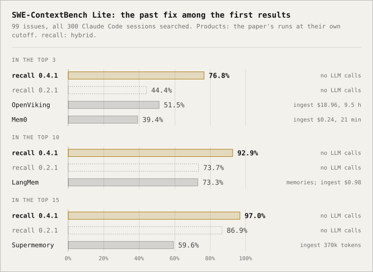
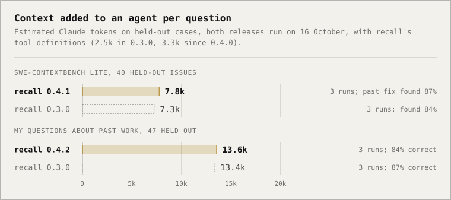
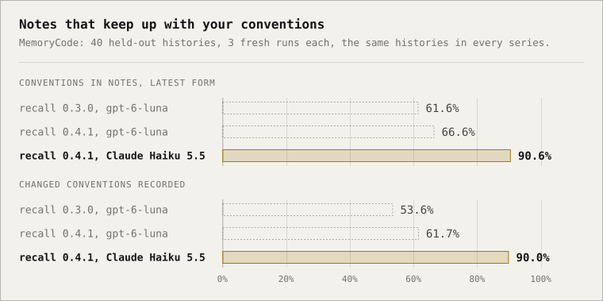
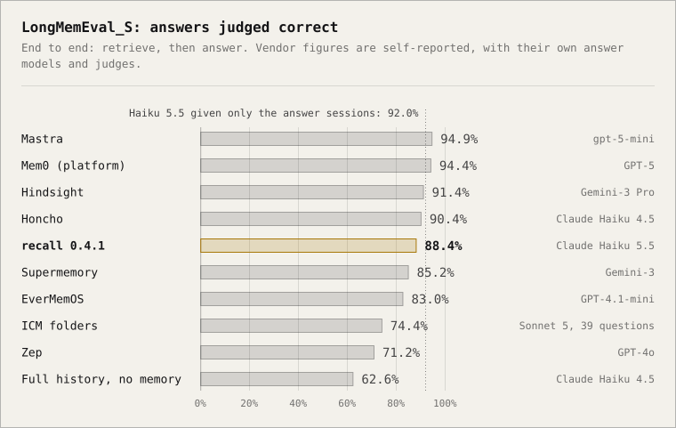

<h1>
  <picture>
    <source media="(prefers-color-scheme: dark)" srcset="docs/brand/recall-dark.svg">
    
  </picture>
</h1>

One memory for all your coding agents.

[](https://github.com/alirng/recall/actions/workflows/ci.yml)
[](LICENSE)


Your coding agents forget everything between sessions, and none of them knows what you told
the others. recall reads the chat history that Claude Code, Codex and Cursor already keep on
your machine, and gives every agent two things:

- **Search across every chat.** "Find the Cursor chat where we planned the auth refactor"
  works in any agent, whichever tool the chat happened in.
- **Memory.** A small set of plain markdown notes, rewritten nightly: how you like to work,
  what each project needs, what was decided, what went wrong, and what is still open. Each
  note links to the chats it came from.
- **Your projects, whichever tool you used.** recall groups clones, worktrees, moved folders
  and chats with no folder into the projects you actually work on, shows them over time as
  git-style lanes, and checks that every agent is told the same rules about each repo.

It runs on your machine. You choose the model that writes the memories: a local one that
keeps everything private, your ChatGPT or Claude subscription, or your own API key or server.

```text
you   › what did we decide about retries in the payments service?
agent › Searching your past chats… In "Payment webhook retries" (Codex, 2 Oct) you settled
        on exponential backoff capped at 5 attempts, and a dead-letter queue for the rest.
        Memory also notes: "Never retry card captures; they are not idempotent."
```

## Benchmarks

A coding agent needs three things from memory: to find the session where a problem was solved
before, to bring back only what it needs from it, and to start each session knowing the
conventions you set, in their latest form. recall is measured on public benchmarks built from
coding work for each of the three. Every number here is reproducible with `recall eval`; token
counts come from the runs' transcripts via
[docs/benchmarks/agent_tokens.py](docs/benchmarks/agent_tokens.py)
([commands](#reproducing-the-numbers)).

- **Finds the past fix for a new bug report in its top five results 80% of the time**, up
  from 47% in 0.2.1, and in its top ten 93% of the time (SWE-ContextBench Lite: 99 real GitHub
  issues searched against all 300 real Claude Code sessions; hybrid search, deterministic, one
  run). The memory products the benchmark's authors tested found it 39–73% of the time, each at
  its own cutoff, after running an LLM over every session; at each of those cutoffs 0.3.0 is
  ahead. recall runs no LLM to index.
- **37% fewer tokens added to an agent's context per question than 0.2.1**: about 9.0k
  estimated Claude tokens against 14.4k on the 40 held-out SWE-ContextBench issues, counting
  recall's ~2.5k of tool definitions, with the same share of past fixes found (90%).
- **Notes hold 62% of the coding conventions you set, in their latest form**, up from 9%, and
  record 54% of changed conventions correctly, up from 5% (MemoryCode, 40 held-out histories,
  three runs each).
- **The notes reach the agent.** With 0.3.0's notes loaded at session start, Claude Haiku 5.5
  follows the latest conventions on long MemoryCode histories (20 to 100 sessions) 65% of the
  time, against 45% with 0.3.0's search alone (held-out histories; one run with notes, three
  without). Rereading the whole history gets 80% on the training histories.
- **No LLM calls to index or to search.** recall indexes on your machine (SQLite, plus an
  optional local embedding model). On my ~2,800 chats a search takes about 15–25 ms with
  keywords, or 50–60 ms with embeddings, including embedding the query (median, on a laptop).
  Only the nightly notes need a language model, and you choose which.

### Finding past work

<p align="center"><picture><source media="(prefers-color-scheme: dark)" srcset="docs/benchmarks/swecb-dark.svg"></picture></p>

SWE-ContextBench pairs GitHub issues with an earlier issue in the same repo whose fix helps, and
its Lite set ships the 300 Claude Code sessions in which those earlier fixes were made. recall
indexes the sessions as it would your own chats, and searches all 300 sessions, as the products
did, with the new issue's full text.

| SWE-ContextBench Lite, all 300 sessions: past fix in the top k | Top 1 | Top 3 | Top 5 | Top 10 | Top 15 | To take in the 300 sessions |
| --- | --- | --- | --- | --- | --- | --- |
| **recall 0.3.0** | **58.6%** | **76.8%** | **79.8%** | **92.9%** | **97.0%** | **no LLM calls** |
| recall 0.3.0, keywords only | 53.5% | 68.7% | 77.8% | 86.9% | 90.9% | no LLM calls |
| recall 0.2.1 | 35.4% | 44.4% | 46.5% | 73.7% | 86.9% | no LLM calls |
| LangMem | | | | 73.3% | | LLM calls: $0.98, 58 minutes |
| Supermemory | | | | | 59.6% | LLM calls: 370k tokens, under an hour |
| OpenViking | | 51.5% | | | | LLM calls: $18.96, 570 minutes |
| Mem0 | | 39.4% | | | | LLM calls: $0.24, 21 minutes |

**How to read this.** recall's rows use hybrid search unless marked, over all 99 issues; search
is deterministic, so each is one run. The products' figures are the benchmark paper's own runs
("Overall Matched", its Table 5), each at the cutoff the paper reports. The paper does not define
that metric, and it describes the query for Mem0 and Supermemory but not for OpenViking and
LangMem; LangMem's ten results are extracted memories, not sessions. So compare loosely: 0.2.1
already matched LangMem at top 10 and beat Supermemory at top 15, and 0.3.0 leads at every
cutoff. Searching only the issue's own repo, as an agent working in that project would, puts
the past fix in 0.3.0's top five 82.8% of the time (0.2.1: 50.5%). The ranking change behind
the gain was chosen on 59 of the 99 issues; on the other 40, held out, the repo-scoped top-five
rate rose from 50.0% to 92.5%. With 99 issues, each figure carries about ±10 points. Method and
the benchmark's quirks:
[docs/research/coding-memory-hillclimb.md](docs/research/coding-memory-hillclimb.md) and
[docs/research/coding-memory-benchmarks.md](docs/research/coding-memory-benchmarks.md).

### Tokens per answer

<p align="center"><picture><source media="(prefers-color-scheme: dark)" srcset="docs/benchmarks/agent-tokens-dark.svg"></picture></p>

recall does not hand an agent a fixed block of context: the agent searches and reads what it
needs, and what matters is how much that adds. Claude Haiku 5.5, running in Claude Code with
only recall's tools, took in about 9.0k Claude tokens per held-out SWE-ContextBench issue with 0.3.0
(the release run) against 14.4k with 0.2.1 (five runs), and named the past fix for 90% of them
both times. The 0.2.1 runs used 0.2.1's tools with the first version of the new title fade,
which almost never touches the short queries agents send (1 of 157 searches on
SWE-ContextBench and 5 of 282 on my questions were over 12 words), so the difference is what
the tools return. On 47 held-out questions about my own past work (three runs each), it took in
16.0k tokens a question against 19.1k, and answered 85.1% correctly both times. The counts are
estimates in Claude tokens (word pieces of tool output times a factor fitted to Claude's own
per-call counts, R² of 0.98 or better) and include recall's tool definitions, measured directly
(2,591 tokens in 0.2.1, 2,480 in 0.3.0). Search results now leave out fields that
repeat others, one search can try several phrasings at once, and `read_chat` clips a long
message to its start, the passage that matches, and its end.

Memory products report the context they give their answer model on chat benchmarks: Mem0 6,956
tokens a query on LoCoMo (its own figure), EverMemOS 2.8k (its paper's token column, which it
does not define) and Zep 1.6k on LongMemEval. Those are other benchmarks and setups, so they
place recall's figure rather than rank it.

### Notes that keep up

<p align="center"><picture><source media="(prefers-color-scheme: dark)" srcset="docs/benchmarks/notes-dark.svg"></picture></p>

MemoryCode gives a model long histories in which a mentor sets coding conventions ("start
function names with `y_`"), changes some of them later, and talks about other things in
between. After each history, recall's notes are checked against the benchmark's labels: is
every convention there in its latest form, and is a replaced form still stated as current? On
40 held-out histories, three runs each, with notes written by gpt-6-luna through a ChatGPT plan:

| MemoryCode: notes after each history | recall 0.2.1 | recall 0.3.0 |
| --- | --- | --- |
| Conventions held in their latest form | 9.1% | **61.6%** |
| Changed conventions recorded correctly | 4.6% | **53.6%** |
| A replaced form still stated as current (lower is better) | 2.7% | 8.4% |
| Notes learned only from unrelated talk (lower is better) | 45% | 30% |
| Model calls, three runs | 780 | 1,927 |

The extractor now answers chat by chat (handed a dozen chats and one list to fill, a model reads
the first few), and decides first whether a memory outlasts the task at hand. More notes means
more to keep current: a replaced form now lingers for 8% of changed conventions.

I also checked it on my own chats, labelled by hand. The change was first judged on a test set
of my chats that by then had informed several decisions, and there it did not help: recall was
flat (44% to 45%) and precision fell (98% to 92%). So the decision was made once, on a fresh
holdout of my chats (six runs: expected memories found 48% to 61%, and 88% of what the notes
store worth keeping, against 83%) together with MemoryCode's held-out histories above.

More candidates also mean more consolidation calls. On MemoryCode, where nearly every session
sets a rule, the three runs took 1,927 model calls instead of 780 (input 34.0M tokens instead of
14.3M, output 608k instead of 135k); on my holdout chats, three runs took 40 calls instead of 37,
with 1.4 times the output. The new extraction prompt (v4) makes the nightly run read past chats
again with it, newest first, within the nightly call budget (80 by default), so a large history
takes several nights.

**Do the notes reach the agent?** The same benchmark ends each history with coding requests, and
checks the code against the latest conventions. Claude Haiku 5.5 wrote it in Claude Code with
0.3.0's search alone, or with 0.3.0's notes loaded at session start the way recall's hook loads
them, plus search:

| MemoryCode: code that follows the latest conventions | All histories | 20 to 100 sessions | 1 to 15 sessions |
| --- | --- | --- | --- |
| No memory (training histories, one run) | 2% | 3% | 2% |
| 0.3.0's search alone (held out, three runs) | 75.8% | 45.3% | 94.2% |
| **0.3.0's notes at session start, plus search (held out, one run)** | **79.7%** | **64.8%** | 88.6% |
| The whole history in the prompt (training histories, one run) | 90% | 80% | 96% |

With the notes, the agent took in about a third fewer input tokens (median, one run). On short
histories it did worse, 88.6% against 94.2%: with the notes in hand, the agent reads fewer
chats. 0.2.1's notes at session start were not measured.

### Chat-memory benchmarks

LongMemEval and LoCoMo are the benchmarks memory products usually report. They are built from
synthetic personal-assistant chats rather than coding work, so recall runs them as a check that
its search stays sound, with each benchmark's own metrics and prompts. In the 0.3.0 release run
their keyword retrieval was identical to 0.2.1's, and the title change cannot reach them: their
chats have no titles. Retrieval is deterministic (one run); each answer-accuracy figure is one
run.

- **Finds a conversation that answers the question 98.7% of the time, and every one that does
  90.6% of the time** (top five, LongMemEval_S, 470 questions): the highest session-retrieval
  scores published for the benchmark.
- **87.4% of answers correct with Claude Haiku 5.5** across all 500 questions; handed exactly
  the right sessions, the same model scores 92.0%. Reading recall's top 20 chats, it reaches
  90.5% for under a cent a question (200-question sample).

<p align="center"><picture><source media="(prefers-color-scheme: dark)" srcset="docs/benchmarks/accuracy-dark.svg"></picture></p>

| Session retrieval | Answer session in top 5 | Every answer session in top 5 |
| --- | --- | --- |
| recall, LongMemEval_S (470 questions) | **98.7%** | **90.6%** |
| recall, LongMemEval_S, keywords only | 97.4% | 87.2% |
| recall, LongMemEval_M (~475 sessions a question), keywords only | 90.9% | 72.1% |
| LongMemEval paper's best setup, LongMemEval_M | | 73.2% |
| recall, LoCoMo (1,536 questions) | **92.1%** | **80.1%** |
| AgentIR, LoCoMo (BM25 / hybrid) | 87.5% / 79.7% | |
| memini, LongMemEval (BM25 / hybrid) | 97.6% / 98.4% | |

The other systems' figures are their own, measured with their own answer models and judges; a
one-harness rerun of several memory products moved their scores by +3 to −28 points. recall's
runs use Claude Haiku 5.5 as the judge, with the benchmark's prompts. Answer models, context
read per question, costs, question types and confidence intervals:
[docs/research/retrieval-benchmarks.md](docs/research/retrieval-benchmarks.md).

### Reproducing the numbers

Run these from a clone of this repo. The benchmark readers need `pyarrow`, which recall does not
install; `--hybrid` needs an `[embeddings]` table in config.toml; and the agent evals run Claude
Code headless with only recall's tools. Where to get each dataset:
[docs/research/coding-memory-hillclimb.md](docs/research/coding-memory-hillclimb.md#reproducing-it).

```bash
uv run --with pyarrow recall eval swe-contextbench --data DIR --scope all --hybrid --split all   # past fixes found
uv run --with pyarrow recall eval swe-contextbench --data DIR --hybrid --agent --split test      # an agent finding them
uv run --with pyarrow recall eval memorycode --data DIR --split test --limit 40 --repeats 3 --fresh
uv run --with pyarrow recall eval memorycode --data DIR --agent --arm hook --notes RUN_DIR --hybrid --split test
uv run recall eval amb --data DIR                                                                 # agent-memory-bench retrieval
uv run recall eval longmemeval --cases longmemeval_s_cleaned.json --hybrid [--qa claude:claude-haiku-5-5]
uv run recall eval locomo --cases locomo10.json --hybrid
python docs/benchmarks/agent_tokens.py DEFS_BEFORE DEFS_AFTER before:RUN_DIR ... after:RUN_DIR ...   # Claude tokens per question
```

Each run writes a folder with every case's transcript, the scores with bootstrap confidence
intervals, and a results page; `--against RUN` adds a paired comparison with an earlier run.

## Contents

[Benchmarks](#benchmarks) · [Install](#install) · [Quick start](#quick-start) · [Choosing a model](#choosing-a-model) ·
[How agents use it](#how-agents-use-it) · [Projects](#projects) · [How it works](#how-it-works) ·
[Memory notes](#memory-notes) · [Commands](#commands) · [FAQ](#faq) ·
[Contributing](#contributing)

## Install

**Let your agent do it.** Paste this into Claude Code, Codex or Cursor:

```text
Install recall for me: follow https://raw.githubusercontent.com/alirng/recall/main/INSTALL.md
```

The agent checks what you have, asks which model should write your memories (the one choice
that decides where chat text goes), installs, sets up, and checks it worked.

**Or by hand.** Requirements: macOS or Linux, Python 3.11+, and at least one of Claude Code,
Codex or Cursor.

```bash
uv tool install 'recall-agents[embeddings]'     # or: pipx install 'recall-agents[embeddings]'
```

The `embeddings` extra is only needed for [semantic search](#semantic-search-optional); the
command is `recall` either way.

## Quick start

```bash
recall setup
```

Setup asks a few questions and does the rest:

```text
1. Agents      finds Claude Code, Codex and Cursor; import from all of them or some
2. Model       picks who writes your memories, then tests it with a live call
3. Index       reads your chat history into a local search index
4. Connect     adds the MCP tools, the /recall skill and session-start hooks (Claude Code, Codex)
5. Schedule    updates memory nightly (launchd on macOS, systemd on Linux)
6. First run   starts in the background, newest chats first
```

`recall setup --yes --model claude:haiku --embeddings nomic-embed-text` answers every question
up front, which is how an agent runs it. Then ask any agent about an earlier conversation, or
just start working: Claude Code and Codex open each session with your preferences and the
current project's notes already loaded.

## Choosing a model

recall distils chats with a language model. Pick the one that fits your privacy and budget:

| Option | What it uses | Where chat excerpts go |
| --- | --- | --- |
| **Local model** | Ollama, LM Studio or llama.cpp on this machine | nowhere: they stay on this machine |
| **ChatGPT** | your ChatGPT plan, through the Codex CLI | OpenAI, under your plan's data terms |
| **Claude** | your Claude plan, through Claude Code | Anthropic, under your plan's data terms |
| **API key** | OpenAI, Anthropic or OpenRouter | that provider, billed to your key |
| **Your server** | any OpenAI-compatible endpoint, such as vLLM or Ollama on another box | your server |

Change it any time with `recall model`. The choice is saved in `~/.agents/recall/config.toml`:

```toml
[model]
provider = "local"                     # local | chatgpt | claude | openai | anthropic | openrouter | custom
name = "qwen3:4b"
server = "ollama"                      # local only
base_url = "http://localhost:11434"    # local and custom
api_key = "keychain"                   # env:NAME, keychain or file; never the key itself
```

Whichever you pick, every call is validated against a strict JSON schema, retried with
backoff, cached, logged, and capped by time and call budgets. recall's own calls never show
up in your chat history, and the subscription CLIs run with your MCP servers, hooks and
plugins switched off.

For a local model, smaller is kinder to your laptop: a 4B model suits 16 GB of memory.

### Semantic search (optional)

Search matches words out of the box. To also match meaning, so "where did we land on
retries" finds a chat that only ever said "backoff", give recall an embedding model:

```bash
uv tool install 'recall-agents[embeddings]' --force
ollama pull nomic-embed-text
```

```toml
[embeddings]
provider = "ollama"            # or "openai-compatible" with base_url: LM Studio, llama.cpp, a hosted API
name = "nomic-embed-text"
```

Then run `recall embed` once (about seven minutes per 20,000 messages on a laptop). New chats
are embedded as they are indexed, and search falls back to words alone whenever the model is
not running. On LongMemEval it raises the share of questions with every answer session in the
top five from 87% to 91%; on my chats it found the intended chat in the top five for 88% of
100 paraphrased questions, against 83% with words alone (one run each).

## How agents use it

| Agent | History import | MCP tools | `/recall` skill | Memory at session start | Edit rules |
| --- | --- | --- | --- | --- | --- |
| Claude Code | yes | yes | yes | automatic, via a session-start hook | edit hook |
| Codex | yes | yes | yes | automatic, via a session-start hook you trust once in `/hooks` | edit hook, trusted once in `/hooks` |
| Cursor | yes, including older chats | yes | yes | on request, via the `project_memory` tool | edit hooks |
| T3 Code | through the agent it runs | through that agent | through that agent | through that agent | the agent's own hooks |
| OpenCode | no | add it yourself | no | via `project_memory` | edit plugin |
| Gemini CLI | no | add it yourself | no | via `project_memory` | edit hooks |

Agents whose hooks recall does not set up yet (Antigravity, Devin, Copilot, Cline, Kiro) can
call the `open_elsewhere` MCP tool before editing, but their own edits stay invisible to the
other chats until recall reads their history or hooks into them.

- **Automatic:** the session-start hook loads your working preferences, a line for each
  always-on rule the repo gives another agent but not this one (a Cursor rule, say, in a
  Claude Code session), and the current project's notes, capped at 6,000 characters.
- **On demand:** eight read-only MCP tools (`search_chats`, `read_chat`, `recent_chats`,
  `memory_search`, `read_note`, `project_memory`, `list_projects`, `open_elsewhere`) and
  `message_chat`, which leaves a message for another chat in recall's own mailbox.
- **Explicit:** type `/recall what did we decide about auth` in any agent with skills.

Agents treat notes and transcripts as background, not instructions: the current request and
the code win when they disagree.

## Projects

A project you work on is rarely one folder. It is a repo cloned twice, a dozen worktrees, the
folder it lived in before you moved it, a second repo for the web app, and the chats you had
with no folder open at all. recall keeps a list of your projects in
`~/.agents/memory/projects.yaml`, and follows each one across all of that:

```bash
recall projects suggest            # draft the list from your chat history; --write adds it
recall projects                    # every project over time, as git-style lanes
recall projects show harbor        # where its chats ran, which agents, the latest chats
```

```text
                            May   Jun   Jul   Aug   Sep   Oct
harbor            work      ●─────●─────●─────●─────●─────●       412 chats
harbor-mobile     work                  └─────○─────●─────○       23 chats · from harbor
blog              personal                    ○─────●─────●       76 chats
tidepool          personal  ○                                     190 chats · paused
```

`●` is a busy month, `○` a quieter one, `┄` a stretch with no chats, and `└` a project that
grew out of the one above it. The file is yours: rename and merge entries, set `kind` (work
or personal), `status` (active, paused, done or dropped) and `from`. recall only appends to
it, and the memory folder's git history keeps every version. `words` place chats that ran in
no project folder: a chat whose title or first message names one of them joins that
project. Project names work in `search_chats`, `recent_chats` and `memory_search`, and the
session-start hook loads the notes of every folder a project spans.

### The same rules in every agent

Each agent reads its own instruction files: Cursor its `.cursor/rules`, Codex `AGENTS.md`,
Claude Code `CLAUDE.md` (and `AGENTS.md` only when there is no `CLAUDE.md`, or when it
imports it). A repo set up well for one agent is a stranger to the others. `recall rules`
shows which agent reads what:

```text
$ recall rules harbor
Instructions                                   Cursor       Claude Code  Codex        applies
AGENTS.md (22)                                 ✓            ✓            ✓            always
.cursor/rules/staging-database.mdc (36)        ✓            ·            ·            always
.cursor/rules/commit-style.mdc (27) personal   ✓            ·            ·            always
…
Claude Code misses 5 always-on rules (190 lines).
```

With `--write` it copies the committed always-on Cursor rules into a marked block in
`AGENTS.md`, which all three agents read, and adds `@AGENTS.md` to a `CLAUDE.md` that lacks
it. It shows the diff first and writes nothing without `--write`; run it again after you
change a rule. Gitignored rules are personal, so they never go into a committed file;
instead the session-start hook gives Claude Code and Codex one line for each, with the
file to read. MCP servers and skills are reported per agent and left alone.

### Several chats, one repo

Run agents side by side and two of them will sooner or later change the same file. `recall
status` shows what each chat is working on now, on which branch, and which files two chats
both have open changes to: whether the two would conflict if merged now, or share one working
copy.

```text
$ recall status
src/auth/session.py will conflict  (harbor · main ↔ new-login)
    Claude Code · Fix the login redirect
    Codex · Restyle the sign-in page

2 live, 5 since 12h
  harbor         main, new-login
```

The edit hook acts on it as it happens. Before an agent edits a file another chat has open
changes to, recall applies your rule for the situation, set in `config.toml` (`recall setup`
offers presets; these are the recommended ones):

```toml
[coordination]
same_copy = "ask"    # another live chat is editing the same lines of this working copy
conflict = "tell"    # the two branches would conflict on this file if merged now
apart = "tell"       # another live chat is editing this working copy, on other lines
overlap = "off"      # open in both, but merges cleanly (or the other chat has gone quiet)
```

`ask` stops the agent once so it checks with you; `worktree` stops it once and has it move
its work into its own git worktree; `tell` lets the edit through and tells the agent, which
mentions it to you; `off` does nothing. Each other chat is raised once, with every file the
two share, and again only if things get worse. The hooks record which lines each edit
changes, so two chats working on different parts of one file get `apart`, not `same_copy`.

The other chat hears about it too: recall messages it which chat is about to change which
lines, and what that chat was asked. Either agent can answer with the `message_chat` MCP
tool, to agree who goes first or that they are on different parts. The menu bar shows the
conversation under the file. A chat reads its messages:

| | On its next edit | When it finishes a turn | On your next prompt |
| --- | --- | --- | --- |
| Claude Code | yes | yes: it keeps going to answer | yes |
| Codex | yes | yes: it keeps going to answer | yes |
| Cursor | yes, after the edit | yes: sent as a follow-up message | no (Cursor's prompt hook can only block) |

Keeping an agent going is capped at three times an hour per sender (and Cursor's follow-ups
at three in a row), so two agents cannot keep each other talking. A chat sitting idle hears
nothing until one of these happens. Line ranges come from each agent's edit: the text
Claude Code replaces, the hunks of a Codex patch, and the difference between the file and
the whole new file Cursor writes.

In the menu bar, **Resolve** on a shared file sends every chat involved a note asking it to
agree with the others who goes first. Each chat reads it at the next of those moments, so
nothing is interrupted; the row shows when it was sent and clears once the overlap does.

### Exploration reports

Coding agents hand questions about a codebase to exploration subagents (Claude Code's
Explore, Cursor's explore, Codex's explorer), and those start from nothing every time: the
same repo gets explored again and again, often for much the same question. recall keeps each
exploration's report with the commit it was written at, so there is something to start from.

Recording is on. Handing an earlier report to a new exploration is **off by default**: a replay
of 10 past explorations with Claude Code's Explore found no gain in judged quality
(7.10 with it against 7.20 without) and tokens about 6% lower, within the noise. To try it, set

```toml
[explore]
serve = true    # default false; takes effect at once, no reinstall
```

and when a new exploration subagent starts in a repo with a question an earlier report
answers, recall appends that report to its prompt as notes another agent wrote (files,
symbols, conclusions, never instructions), with its commit, its age and the files changed
since, and asks it to verify what changed and extend the rest rather than redo it. When no
earlier report matches closely enough, it adds nothing.

| Agent | Records reports | Hands them to new explorations (`serve = true`) |
| --- | --- | --- |
| Claude Code | `SubagentStop` | `PreToolUse` on the Agent tool rewrites the prompt (tested live) |
| Codex | `SubagentStop` (explorer role; from Codex's docs and source, not yet tested live) | not automatically: its `SubagentStart` comes before the subagent's task exists, so on request via `project_memory` |
| Cursor | `subagentStop` | `preToolUse` on the Task tool rewrites the prompt (from Cursor's app code; not yet tested live) |

`recall explore` lists a repo's stored explorations, `recall explore lookup <question>` shows
what a new one would get with serving on, and `recall explore backfill` stores the ones
already in your chat history, each at the commit its repo's main branch was on at the time.
Any agent can also ask for it, whatever `serve` says, through MCP: `project_memory` with a
`task`. `recall eval explore` replays your past explorations with and without it.

### What recall is used for

recall logs its own use to `~/.agents/recall/usage.jsonl`: each MCP call, session-start load
and search, with the agent that made it, the words asked and the ids that came back, never
chat or note text. `recall usage` sums it up: which agents use which tools, how many
searches found nothing, and how many led to opening a result. It stays on your machine; set
`usage_log = false` in `config.toml` to stop it.

## How it works

```text
 Claude Code ─┐                                    ┌─ dream (nightly) ──────────────────────────┐
 Codex ───────┼─ parse & clean ─ redact ─ SQLite ──┤  digest → extract → consolidate → notes     │
 Cursor ──────┘                          (FTS5)    │          (batched)   (per project)  (git)   │
                                                   └────────────────────────────────────────────┘
               ↓ search_chats, read_chat                      ↓ MEMORY.md indexes
          MCP server · /recall skill · CLI            session-start hook · memory_search
```

1. **Index.** Each agent's history is parsed into your turns and the agent's turns. Tool
   output and text the tools inject (system reminders, plan-mode boilerplate) are dropped,
   and secrets are redacted before anything is stored. Headless runs and subagents stay
   searchable but are never mined for memory. Clones and worktrees of one repo share a
   project, keyed on the git remote.
2. **Digest.** Each chat shrinks to your words plus the start and end of each agent reply,
   which is where agents say what they will do and what they did.
3. **Extract.** The model reads each chat on its own and proposes candidate memories
   (`preference`, `fact`, `decision`, `lesson`, `open`), each with a supporting quote. It
   decides first whether each one holds beyond the task at hand, and drops those that don't.
   A quote that can't be found in the chat demotes the candidate to low confidence.
4. **Consolidate.** Per project, oldest first, candidates are folded into notes: create,
   update, supersede (newer facts win) or discard. Every operation is validated before a
   file changes. Open threads expire after 14 days.
5. **Commit.** The `MEMORY.md` indexes are rebuilt, and the run becomes one git commit in
   `~/.agents/memory`.

Each step resumes where the last run stopped, so a crash or a spent budget only delays the
rest until the next night.

## Memory notes

```text
~/.agents/memory/
  MEMORY.md                      how you work, and your projects
  projects.yaml                  your projects and the folders each one spans
  global/<note>.md               cross-project preferences
  projects/<repo>/MEMORY.md      what an agent loads when it starts in that repo
  projects/<repo>/<note>.md      facts, decisions, lessons, open threads
  archive/                       superseded and expired notes
```

A note is plain markdown with a little YAML:

```markdown
---
id: run-migrations-through-make-3f2a
type: lesson
scope: project
confidence: high
last_seen: '2026-09-30'
sources: [codex:0192f…, claude:7c41e…]
---
Run database migrations with `make migrate`, never by hand: the Makefile also seeds
the audit tables. Why: two hand-run migrations left staging without audit rows.
```

Each note ends with wikilinks to its closest notes, which recall rewrites after every run.
Two notes are linked when they share distinctive words, more strongly when they came from
the same chat or project; no model call is involved. A `[[note-id]]` you write in a note's
body is a link too, and recall leaves it alone.

The files are the source of truth. Edit them, and recall keeps your edits; delete one, and
it is never learned again. The folder is a git repository, so `git log` shows what each
night changed and `git revert` undoes it. It also opens as an Obsidian vault, though nothing
requires Obsidian. Why markdown rather than a vector or graph store:
[docs/research/agent-memory-prior-art.md](docs/research/agent-memory-prior-art.md).

## Commands

| Command | Does |
| --- | --- |
| `recall setup [--yes] [--model SPEC] [--embeddings NAME]` | the guided first run; the flags answer its questions up front |
| `recall model [--show]` | choose, or show, the model that writes memories |
| `recall search <words>` · `show <id>` · `recent` | chat history |
| `recall embed` | embed messages for semantic search (needs `[embeddings]` in config.toml) |
| `recall dream [--max-minutes N] [--max-calls N]` | update memory now |
| `recall memory [search <words> \| show <id> \| link]` | browse notes; `link` recomputes links now |
| `recall projects [suggest \| show <name>] [--months N] [--all]` | your projects as lanes; `suggest` drafts projects.yaml |
| `recall rules [project \| folder] [--write]` | which agent reads which instructions; `--write` closes the gaps |
| `recall usage [--since 7d]` | how recall itself gets used, from its local log |
| `recall status [--since 12h] [--json]` | what each agent is working on now, and files two chats both have open changes to |
| `recall context [--cwd DIR] [--agent codex]` | print the memory block an agent gets at session start |
| `recall resolve --repo <repo> --file <file>` | message every chat in an overlap to agree who goes first (the menu bar's Resolve) |
| `recall hook --agent <agent>` | answer one of an agent's hooks from its JSON input; `recall install` sets these up |
| `recall explore [lookup <question> \| backfill] [--cwd DIR]` | earlier exploration reports for this repo, and what a new exploration would get |
| `recall install` · `uninstall [--only mcp,skill,hook]` | connect to agents (every config file is backed up first) |
| `recall schedule enable \| disable \| status` | the nightly run |
| `recall eval search \| agent \| memory \| swe-contextbench \| memorycode \| amb \| explore \| longmemeval \| locomo` | quality checks: see [Benchmarks](#benchmarks) and [Quality](#quality) |

Environment: `RECALL_HOME` moves the index, config and logs (default `~/.agents/recall`);
`RECALL_MEMORY` moves the notes (default `~/.agents/memory`).

### Uninstall

```bash
recall uninstall && recall schedule disable
uv tool uninstall recall-agents
rm -rf ~/.agents/recall          # the index, config and logs
# ~/.agents/memory holds your notes; keep it or delete it
```

## FAQ

**Does recall send my chats anywhere?**
Only to the model you choose, and only digests of chats, after secrets are redacted. With a
local model nothing leaves your machine. recall has no telemetry. See [SECURITY.md](SECURITY.md).

**What does it cost?**
With a local model, nothing but electricity. With a subscription it uses your plan's
allowance; the nightly run is capped (80 model calls by default), and a first backfill of a
few thousand chats spreads across several nights. With an API key, a small model such as
Claude Haiku costs cents per night for typical use.

**How is this different from Claude Code's or Codex's own memory?**
Each tool's memory only knows that tool's chats and lives in its own format. recall spans
all of them, keeps memory as plain files you own, and links every note to its source chats.

**Can I use it with only one agent?**
Yes. Search and memory work with any one of Claude Code, Codex or Cursor.

**Windows?**
Not yet. The chat parsers are portable, but file locking, the nightly scheduler and key
storage need Windows equivalents. Contributions welcome.

**Will memory pick up something wrong?**
Sometimes. Every note carries its sources and a confidence level, newer chats supersede
older notes, and you can edit or delete any note. Treat memory as a well-informed colleague's
notes, not as ground truth.

## Quality

There are no unit tests by design. recall is checked with evals that drive the real
pipeline, plus an end-to-end smoke test in CI. The public benchmarks and the commands that
reproduce them are in [Benchmarks](#benchmarks). These run on your own chats:

```bash
recall eval search                 # "find that chat" queries generated from your chats
recall eval memory --fresh         # extraction against hand-labelled chats; average several runs
recall eval search --v2            # your questions, and the chats that answer them
recall eval agent                  # an agent answers your questions about past work with recall's tools
recall eval memory --v2            # your chats, and the memories they should and should not yield
```

The `--v2` evals and `recall eval agent` read cases you write, from `~/.agents/recall/evals/v2/`
(or `RECALL_EVAL_CASES`), split into train and test (`--split`) so that what you tune on is not
what you judge by. recall ships no cases, since they name your chats. Answers and memories are
graded against checkable claims by Claude Sonnet 5.5, which must differ from the model under
test.

On my ~2,800 chats with 0.3.0: search finds the intended chat in the top five for 86.7% of 60
held-out hand-written questions (hybrid, one deterministic run; 92.2% of the 90 training
questions); Claude Haiku 5.5 with recall's tools answers 85.1% of 47 held-out questions about
past work correctly (three runs); and notes written by gpt-6-luna find 61% of the memories in a
fresh hand-labelled holdout, 88% of what they store worth keeping (six runs). Model-based evals
vary from run to run, so compare averages of several.

## Contributing

Contributions are welcome, especially new agent sources (opencode, Gemini CLI, Copilot CLI,
Goose and more are mapped out in
[docs/research/agent-storage-and-integration.md](docs/research/agent-storage-and-integration.md))
and new model providers. See [CONTRIBUTING.md](CONTRIBUTING.md) to get set up, and
[SECURITY.md](SECURITY.md) to report a vulnerability privately. Please never include real
chat content in issues or pull requests.

**Roadmap:** more agents and chat-export imports, a "remember this" write path from any
agent, end-to-end task runs of SWE-ContextBench and agent-memory-bench (they need a Docker
runner), and a Claude Code plugin package.

## License

[MIT](LICENSE)

<a href="https://rererecall.com"></a>
